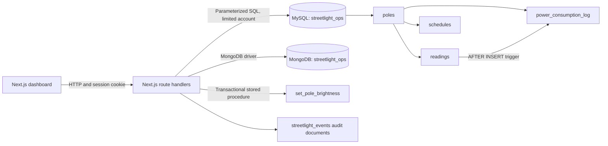
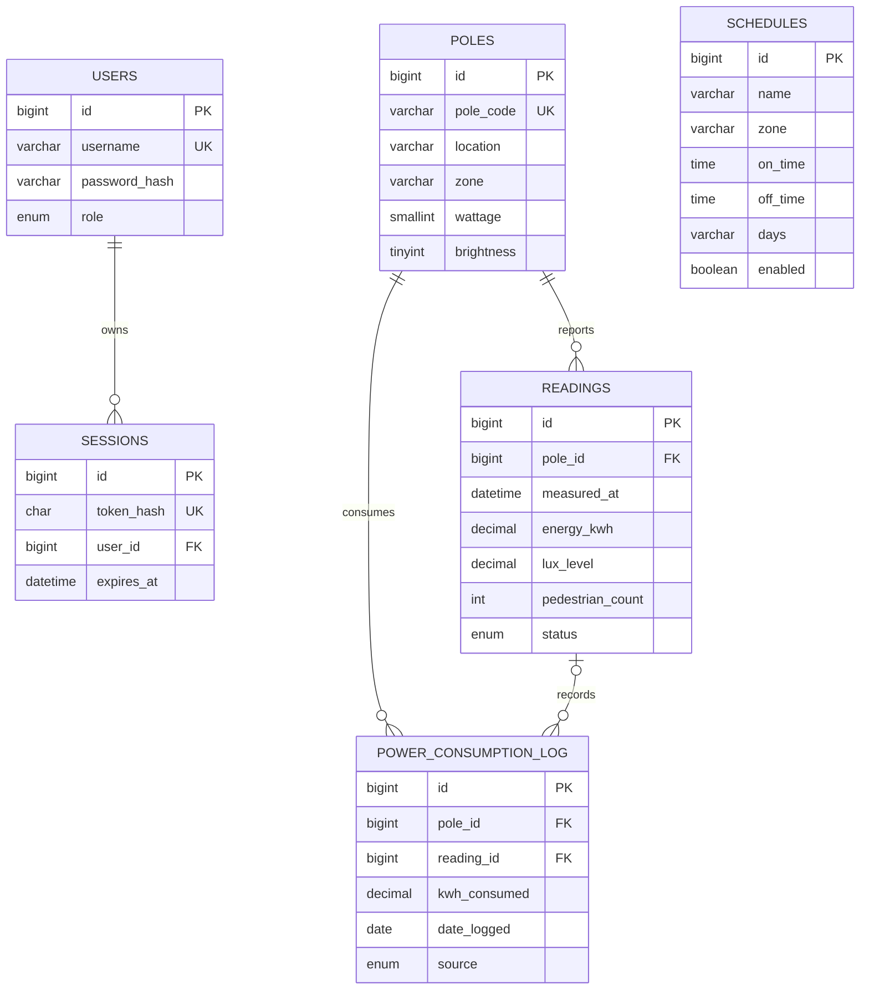

# Smart Street Lighting — Project Design

## Objectives

Provide a web interface for monitoring street-light assets, readings, schedules,
and energy. Authenticated operators can maintain pole and schedule data, record
sensor readings, and change brightness. Viewers can inspect the dashboard but
cannot write. MySQL protects operational records and transactional changes;
MongoDB stores flexible operator audit events and supports document search and
aggregation.

## Architecture

`streetlight_ops` is the authoritative database used by the dashboard. The
separate `smart_streetlight_grid` schema is a companion SQL demonstration
retained for the original course SQL examples; it is not connected to the web
application. Database credentials are generated/configured locally in the
ignored `next-app/.env.local`; never commit that file.

## Relational model

`schedules` apply to a zone rather than a single pole. The `readings_pole_measured_at`
unique key prevents duplicate samples for the same pole/time. Foreign keys
cascade pole deletion to its readings, schedules are zone-owned, and log
references become `NULL` if their source reading is removed.

## Data dictionary and integrity

| Table | Important fields | Keys and rules |
|---|---|---|
| `users` | `username`, `password_hash`, `role` | Unique username; role is `viewer` or `operator`; passwords are bcrypt hashes |
| `sessions` | `token_hash`, `user_id`, `expires_at` | Unique token hash; user foreign key cascades; indexed by user and expiry |
| `poles` | `pole_code`, `location`, `zone`, `wattage`, `brightness` | Unique pole code; wattage 1–5000; brightness 0–100 |
| `readings` | `pole_id`, `measured_at`, `energy_kwh`, `lux_level`, `pedestrian_count`, `status` | Pole foreign key; unique pole/time; nonnegative energy/lux; controlled status |
| `schedules` | `name`, `zone`, `on_time`, `off_time`, `days`, `enabled` | Unique zone/name; nonempty days; enabled/zone index |
| `power_consumption_log` | `pole_id`, `reading_id`, `kwh_consumed`, `date_logged`, `source` | Pole and optional reading foreign keys; nonnegative kWh; pole/date and date indexes |

The executable table definitions, indexes, views, trigger, and stored procedure
are in [`../next-app/sql/schema.sql`](../next-app/sql/schema.sql). Sample rows
are in `next-app/sql/seed.sql`.

## Database choices and advanced concepts

- **MySQL** stores accounts, sessions, poles, readings, schedules, and energy
  logs. Foreign keys/checks protect data; prepared statements protect route
  queries. `v_pole_summary` and `v_dimming_schedule` supply dashboard summaries.
- **Stored procedure and transaction:** `set_pole_brightness` locks the target
  pole, validates brightness and existence, updates its value, logs estimated
  energy, and commits; SQL errors roll back and are re-signaled.
- **Trigger:** `trg_reading_power_log` writes a linked power-log entry after
  each new reading.
- **Indexes:** primary/unique keys and workload-specific indexes support
  newest readings, pole/time lookup, active schedule summaries, and energy
  aggregation.
- **MongoDB:** `streetlight_events` stores actor/action/entity, bounded event
  details, and a timestamp. Timestamp, action/time, actor/time, and text
  indexes support the interface. A `$facet` aggregation returns recent events,
  counts by action, and hourly activity.
- **Analytics:** `next-app/sql/analytics.sql` and
  `sql file for project/07_analytics.sql` demonstrate joins, grouping,
  aggregates, `HAVING`, ordering, derived tables, and subqueries.

## Application and security

The App Router UI and API are in `next-app/src/`. MySQL and MongoDB connections
are server-only. Passwords are bcrypt-hashed; random session tokens are
SHA-256-hashed before storage; cookies are HTTP-only, same-site, and time
limited. Mutating browser requests require a same-origin `Origin` header.
Viewers can read dashboard/telemetry data; operators can write, change
brightness, and delete schedules. The setup creates a least-privilege
MySQL account and fresh demo operator/viewer accounts.

## Run and verify

Use the repository-root PowerShell launcher in [`../README.md`](../README.md)
to initialize both databases, provision MongoDB indexes and app accounts,
build, and run the website. `npm test`, `npm run typecheck`, and `npm run build`
run from `next-app/`. Capture actual screenshots and test results for the
submission rather than claiming checks that were not performed.

## Remaining student confirmations

The repository cannot prove the section title is unique, that the team has
instructor approval, that both students made genuine database and application
contributions, or that all course originality/citation rules have been met.
Confirm these with the team and instructor before submission.
